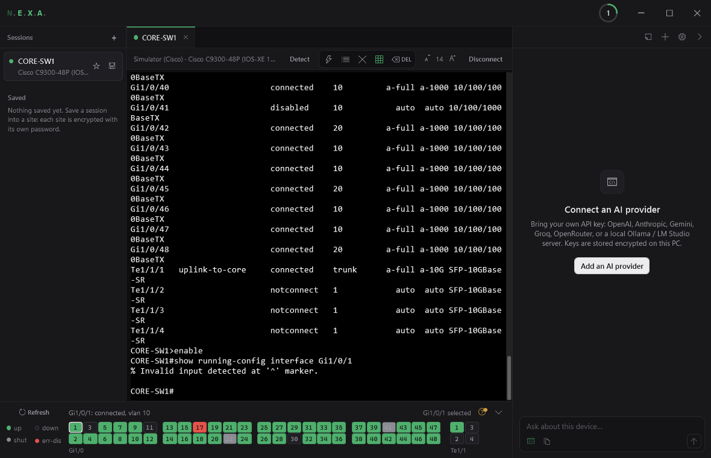
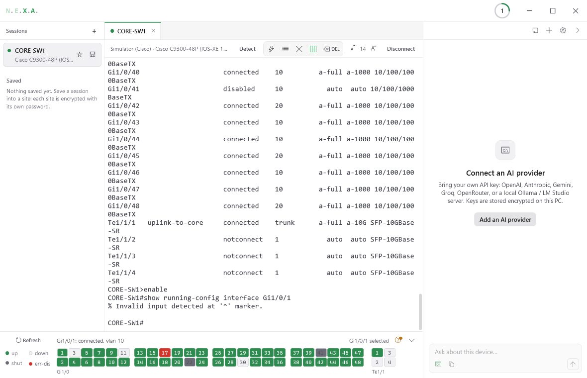
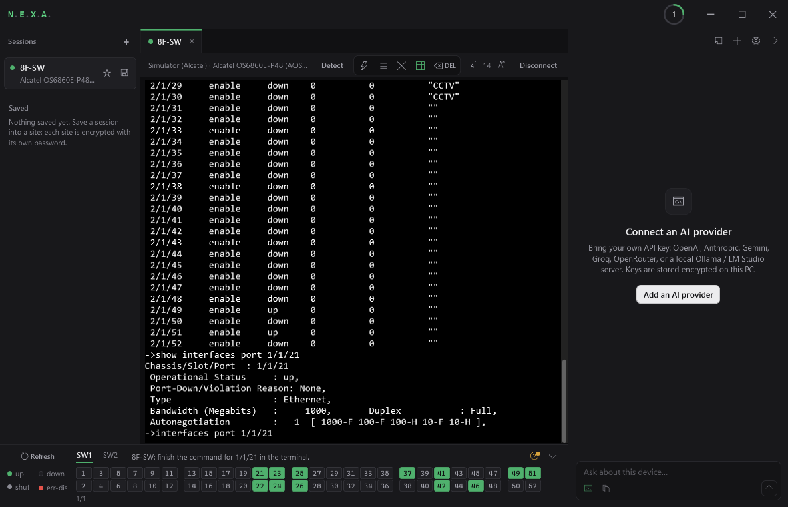

# N.E.X.A.

**Network Engineering EXecution Assistant**: a console for network engineers on Windows.

Serial, SSH and Telnet sessions in tabs, with device detection, a live port faceplate, encrypted saved
sites, session logging and an optional AI assistant.

## Download

From the [latest release](https://github.com/DEVERA4K/NEXA/releases/latest):

| File | What it is |
|---|---|
| `NEXA-0.2.0-setup.exe` | Installer. Just for you (no admin) or for all users. Start menu entry, uninstall from Apps. |
| `NEXA-0.2.0-portable-win-x64.zip` | Portable. Unzip and run `NEXA.exe`; settings stay in a `data` folder beside it. |

Windows 10 or 11, x64. No .NET install needed.

The builds are not code-signed yet, so SmartScreen may show "unknown publisher": **More info → Run anyway**.
SHA-256 checksums are in the release notes.

## What it does

- **Sessions:** serial (auto-baud), SSH (known-host checking), Telnet, and a built-in simulator for practice. One tab per device.
- **Detect:** identifies vendor, model and OS from what the device prints, without typing into login or pager prompts.
- **Faceplate:** live port map from the device's own status output: up, down, shut, err-disabled, stack and virtual-chassis members. Click a port to show it, double-click to configure it.
- **Safety:** nothing is sent until the device is detected and at its own prompt; configuration pastes are confirmed; reload/erase always.
- **Saved sites:** connections grouped into sites, each encrypted with its own password.
- **Logs:** save a session, or write every session to a file as it runs.
- **AI assistant (optional):** your own provider and key (OpenAI, Anthropic, Gemini, Groq, OpenRouter) or a local model (Ollama, LM Studio). Passwords, keys and SNMP communities are masked before anything is sent.
- **Dark and light themes.**

## Devices

| Platform | Status |
|---|---|
| Cisco IOS / IOS-XE | Checked on hardware |
| HP / H3C Comware | Checked on hardware |
| Alcatel-Lucent OmniSwitch (AOS 6/7/8) | Provisional: port table and config checked against real captures |
| Aruba AOS-Switch, AOS-CX | Provisional: from vendor documentation |
| FortiOS | Basic |

| Light | Alcatel OmniSwitch virtual chassis |
|---|---|
|  |  |

## Issues

Report bugs and unsupported devices in [Issues](https://github.com/DEVERA4K/NEXA/issues). For a device that
isn't recognised, include its `show version` (or equivalent) and port status output, with addresses and
names removed.

## Licence

Freeware: free to use, at home or at work, and to share unchanged. Not to sell, modify or reverse engineer.
See [LICENSE](LICENSE). Third-party components and their licences are listed in `THIRD-PARTY-NOTICES.txt`,
included in both downloads.

© 2026 DEVERA. All rights reserved.
